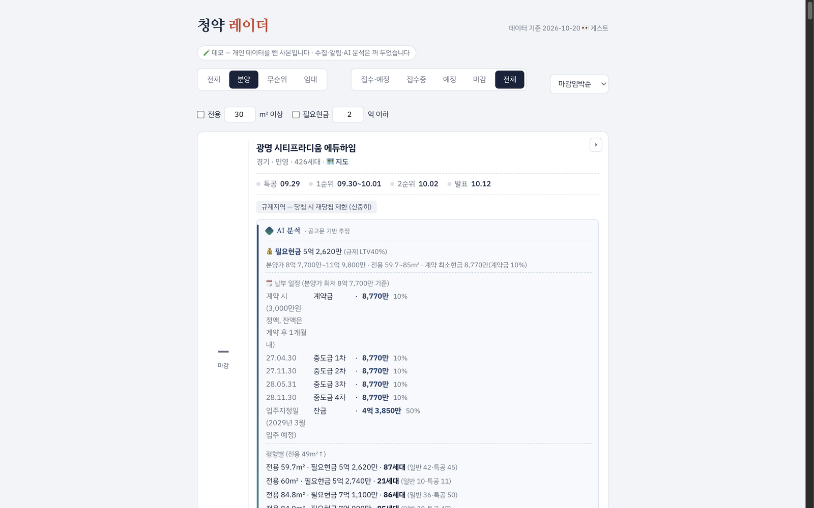
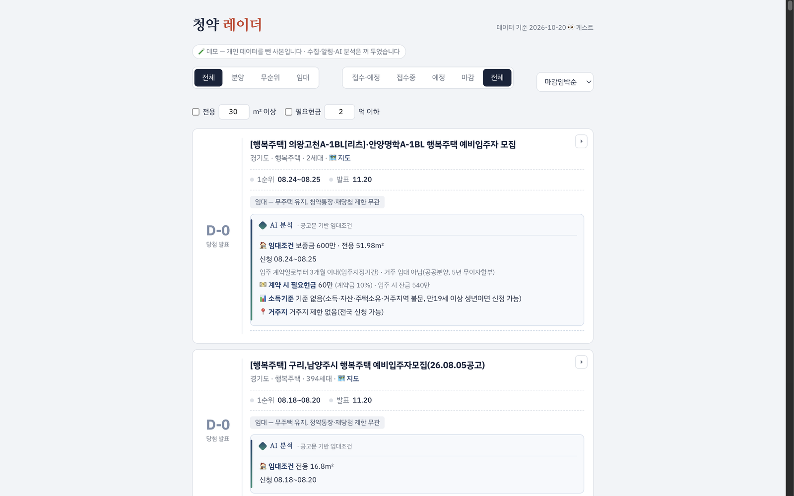

<h1 align="center">청약 레이더</h1>

<p align="center"><b>서울 · 경기 청약 공고를 모아 새 공고와 접수 일정을 텔레그램으로 알려 주는 셀프호스팅 대시보드</b><br>
청약홈 · LH · SH · 청년안심주택 공고를 한곳에서 보고, 필요현금 · 통근시간 · 소득기준까지 계산합니다.</p>

<p align="center">


</p>

<p align="center"></p>

## 주요 기능

- **공고 수집** - 공공데이터포털 API(한국부동산원 청약홈 · LH) + SH · 청년안심주택 · 중소벤처기업부 게시판을 주기적으로 수집하고, 같은 공고를 묶어 중복 없이 보여 줍니다.
- **텔레그램 알림** - 새 공고 즉시 알림, 접수 시작 · 마감 D-7 / D-1 리마인더, 관심단지 알림.
- **필요현금 계산** - 주택형별 분양가와 계약금 · 중도금 비율로 계약 시 필요현금, 납부 일정, 대출(LTV) 반영 자기자본을 계산합니다.
- **통근시간 태그** - 공고 주소에서 목적지까지 대중교통 소요시간 · 환승 횟수(카카오 + ODsay).
- **자격 · 상황 태그** - 분양 / 임대, 규제지역 재당첨 제한, 예비신혼 · 신혼 모드에 맞춘 행동 안내, 유형별 소득요건.
- **AI 공고 분석(선택)** - 공고문 PDF 에서 임대조건 · 계약금 비율 · 소득기준을 뽑아 요약합니다.
- **웹 대시보드** - 접수중 / 예정 / 마감, 분양 · 무순위 · 임대 필터, 면적 · 필요현금 필터, 구글 캘린더 구독(.ics).
- **REST API** - FastAPI 로 공고 · 상태 · 설정 · 수집 실행 API 제공.

## 빠른 시작

```bash
git clone https://github.com/Nelef/chungyak-radar.git && cd chungyak-radar
cp .env.example .env               # 키 · 토큰 입력(키 없이 MOCK=1 로 먼저 확인 가능)
cp config.example.yaml config.yaml # 내 조건(지역 · 관심단지 · 가구 상황)
docker compose up -d --build
# -> http://localhost:8899
```

1. `.env` 를 `MOCK=1` 로 두고 띄우면 샘플 공고 3건이 대시보드에 보입니다.
2. 텔레그램 토큰을 넣고 `curl -X POST http://localhost:8899/api/test-telegram` 으로 알림을 확인합니다.
3. API 키를 넣고 `MOCK` 을 지운 뒤 `docker compose restart`. 대시보드의 **지금 수집** 으로 바로 수집할 수 있습니다.

## API 키 발급(무료)

| 키 | 어디서 | 용도 |
|---|---|---|
| `APPLYHOME_API_KEY` | [공공데이터포털](https://www.data.go.kr) "한국부동산원_주택청약 분양정보 조회 서비스" 활용신청 -> 일반 인증키(Decoding) | 청약홈 APT · 무순위 공고 |
| `LH_API_KEY` | 공공데이터포털 "한국토지주택공사_분양임대공고문 정보" | LH 공공분양 · 임대 |
| `TELEGRAM_BOT_TOKEN` · `TELEGRAM_CHAT_ID` | 텔레그램 `@BotFather` -> `/newbot`, 봇에게 메시지를 보낸 뒤 `getUpdates` 로 chat id 확인(여럿이 받으려면 그룹방 id) | 알림 |
| `KAKAO_REST_KEY` · `ODSAY_API_KEY` (선택) | [developers.kakao.com](https://developers.kakao.com) · [lab.odsay.com](https://lab.odsay.com) | 통근시간 태그 |

## 설정

**환경 변수(`.env`)**

| 변수 | 설명 |
|---|---|
| `MOCK` | `1` 이면 API 키 없이 샘플 데이터로 동작 |
| `DASHBOARD_PASSWORD` | 대시보드 로그인 비밀번호(비우면 게이트 없음) |
| `DASHBOARD_URL` | 텔레그램 알림에 넣을 대시보드 주소 |
| `COMMUTE_DEST_NAME` · `COMMUTE_DEST_X` · `COMMUTE_DEST_Y` | 통근 목적지 이름 · 경도 · 위도(기본 서울시청) |
| `CAL_TOKEN` | 구글 캘린더 구독 주소(`/cal/<CAL_TOKEN>.ics`)의 비밀값 |
| `DEMO_MODE` | `1` 이면 로그인 없는 읽기 전용 데모(수집 · 알림 · AI 꺼짐) |

**AI 공고 분석(선택)** - 아무 키도 없으면 이 기능만 꺼지고 수집 · 알림 · 대시보드는 그대로 돕니다.

| 변수 | 설명 |
|---|---|
| `GEMINI_API_KEY` · `GEMINI_FREE_API_KEY` | Google AI Studio Gemini API 키(공고 분석 1순위) |
| `CHUNGYAK_CLAUDE_TOKEN` | Claude Code CLI(`claude -p`)로 부를 때 `claude setup-token` 으로 받은 토큰 |
| `ALT_LLM_URL` · `ALT_LLM_KEY` | LiteLLM 같은 Anthropic 호환 프록시 |

**필터(`config.yaml`)** - 관심 지역(`regions`), 관심단지(`watchlist`), 제외 키워드, 리마인더 시점(`reminders: [7, 1]`), 통근 기준(`commute.max_minutes` · `exclude_over`), 필요현금 계산(LTV · 대출 한도), 가구 상황(`mode: premarital | married`, `profile`). 예시는 [`config.example.yaml`](config.example.yaml).

## 스크린샷

| 공고 목록 - AI 분석(임대조건 · 필요현금 · 소득기준) | 분양 공고 - 필요현금 · 납부 일정 |
|---|---|
|  |  |

## 프로젝트 구조

```
app/main.py        FastAPI + APScheduler(수집 60분 주기, 리마인더 08:30)
app/sources.py     청약홈 · LH API 클라이언트(+ MOCK 샘플)
app/boards.py      SH · 청년안심주택 · 중기부 게시판 수집
app/cost.py        분양가 · 필요현금 · 공고문 PDF 분석
app/rules.py       지역 필터 · 상황 태그 · 알림 메시지
app/commute.py     통근시간(카카오 + ODsay, 캐시)
app/ical.py        캘린더 구독(.ics)
app/notify.py      텔레그램 발송
app/db.py          SQLite(공고 · 알림 중복 방지)
web/index.html     대시보드
```

## 알아 둘 것

- 기관 API 필드명이 바뀔 수 있습니다. 수집이 0건이면 `docker compose logs` 로 확인하세요(필드가 빠지면 건너뛰도록 작성돼 있습니다).
- 신규 택지지구는 지번이 없어 좌표 변환이 실패할 수 있고, 통근시간은 현재 교통망 기준입니다.
- 게시판 수집은 각 사이트 이용 조건을 지키고 요청 간격을 두고 쓰세요.
- 알림과 계산은 참고용입니다. 신청 전에는 반드시 입주자모집공고 원문으로 자격 · 일정을 확인하세요.

## 라이선스

[MIT](LICENSE)
